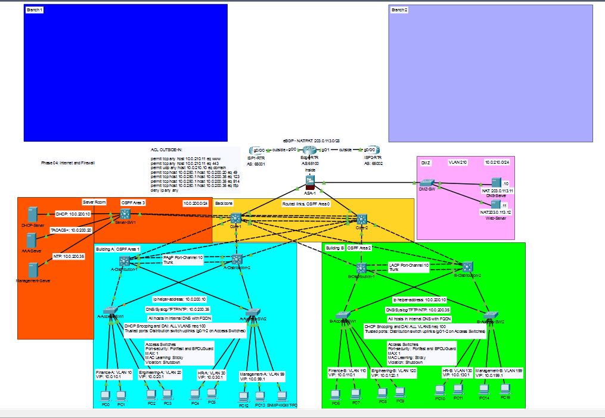

# TNARC Lab 05: Branch Expansion over Encrypted Internet VPNs

## The Problem
TNARC is opening two separate branches, Branch 1 and has aquired a firm (branch 2) that runs EIGRP. Leased private lines are slow to order and expensive, so both branches will connect over ordinary business internet. Client finanacial data will cross the internet so EVERY company flow between sites must be encrypted. Both branches will need HQ's services (DHCP, DNS, AAA, logging) and its servers, and HQ's firewall must still inspect what reaches them. The design must be capable of scaling so when a new branch joins nothing is redesigned. 

## Requirements
1. Every site reaches every other site.
2. All traffic between sites is encrypted.
3. Routes are exchanged dynamically over the tunnels.
4. OSPF and EIGRP share routes at exactly one point.
5. Branch user reach the internet through their own connections.
6. Branch traffic to HQ is inspected by the ASA, with only the needed flows allowed.
7. Branch users get addresses from the HQ DHCP server.
8. Every new device meets Stage 2 and 3 baselines.
9. Tunnels survive the failure of ISP1 at HQ.

## Topology

## Network Addressing
| Block | Use | Notes |
|-------|-----|-------|
| 203.0.113.15/32 | HQ-Edge-RTR Loopback1 - Tunnel endpoint | Spare address from TNARC's block |
| 198.51.100.8/30 | ISP1 -> ISP2 | Connection between ISPs for Failover, wishful thinking as it is not currently possible with this router |
| 198.51.100.12/30 | BR1-Edge-RTR -> ISP1 | Public address comes from ISP1 |
| 198.51.100.16/30 | BR2-Edge-RTR -> ISP2 | Public address comes from ISP2 |
| 10.0.253.0/30 | Tunnel1 - HQ-Edge-RTR -> BR1-Edge-RTR | Tunnel address | 
| 10.0.253.4/30 | Tunnel2 - HQ-Edge-RTR -> BR2-Edge-RTR | |
| 10.1.0.0/16 | Branch 1 LANs | Follows the same pattern as HQ for VLANs. |
| 172.16.0.0/16 | Branch 2 LANs (acquired) | Chose this address to spot the EIGRP standout |

## Key Decisions

## Verification

## Challenges and Fixes

## What I'd do next 
