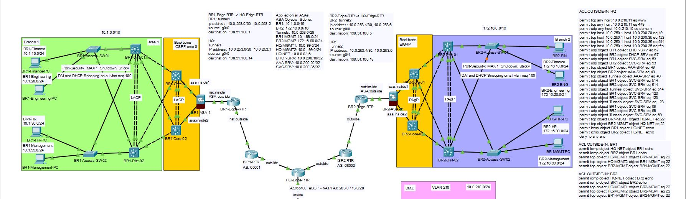
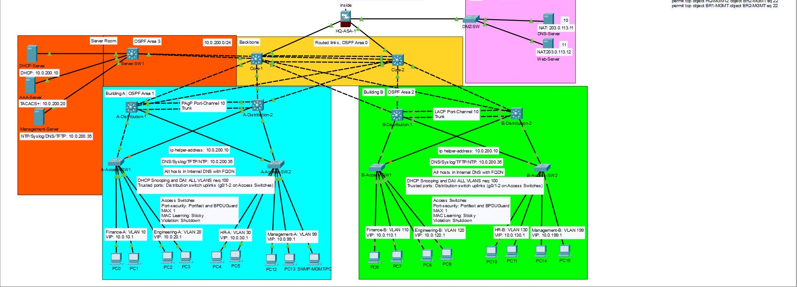

# TNARC Lab 05: Branch Expansion over Encrypted Internet VPNs

## The Problem
TNARC is opening two separate branches, Branch 1 and has aquired a firm (branch 2) that runs EIGRP. Leased private lines are slow to order and expensive, so both branches will connect over ordinary business internet. Client finanacial data will cross the internet so EVERY company flow between sites must be encrypted. Both branches will need HQ's services (DHCP, DNS, AAA, logging) and its servers, and HQ's firewall must still inspect what reaches them. The design must be capable of scaling so when a new branch joins nothing is redesigned. 

## Requirements
1. Every site reaches every other site.
2. All traffic between sites is encrypted.
3. Routes are exchanged dynamically over the tunnels.
4. OSPF and EIGRP share routes at exactly one point.
5. Branch user reach the internet through their own connections.
6. Branch traffic to HQ is inspected by the ASA, with only the needed flows allowed.
7. Branch users get addresses from the HQ DHCP server.
8. Every new device meets Stage 2 and 3 baselines.
9. Tunnels survive the failure of ISP1 at HQ.

## Topology
#### Branch 1
| Device | Model | Role |
|--------|-------|------|
| BR1-Edge-RTR | 2911 | Connects the Network to ISP1 (ISP2 in a real scenario as failover) |
| BR1-ASA-1 | 5506-X | Filtering and Policy management for the branch |
| BR1-Core-1 | 3650 | Routed ports for traffic from Dist 1 and 2, failover with Core-2 via HSRP |
| BR1-Core-2 | 3650 | Routed ports for traffic from Dist 2 and 1, failover with Core-1 via HSRP |
| BR1-Dist-1 | 3650 | STP: Root primary for VLANs 10 and 20. Failover for VLANs 30,99. |
| BR1-Dist-2 | 3650 | STP: Root primary for VLANs 30 and 99. Failover for VLANs 10,20. |
| BR1-Access-SW1 | 2960 | Hosts VLANs 10 and 20, Port-security with maximum 1 MAC, sticky learning and shutdown violation |
| BR1-Access-SW2 | 2960 | Hosts VLANs 30 and 99, Port-security with maximum 1 MAC, sticky learning and shutdown violation |

#### Branch 2 
| Device | Model | Role |
|--------|-------|------|
| BR2-Edge-RTR | 2911 | Connects the Network to ISP2 (ISP1 in a real scenario as failover) |
| BR2-ASA-1 | 5506-X | Filtering and Policy management for the branch |
| BR2-Core-1 | 3650 | Routed ports for traffic from Dist 1 and 2, failover with Core-2 via HSRP |
| BR2-Core-2 | 3650 | Routed ports for traffic from Dist 2 and 1, failover with Core-1 via HSRP |
| BR2-Dist-1 | 3650 | STP: Root primary for VLANs 10 and 20. Failover for VLANs 30,99. |
| BR2-Dist-2 | 3650 | STP: Root primary for VLANs 30 and 99. Failover for VLANs 10,20. |
| BR2-Access-SW1 | 2960 | Hosts VLANs 10 and 20, Port-security with maximum 1 MAC, sticky learning and shutdown violation |
| BR2-Access-SW2 | 2960 | Hosts VLANs 30 and 99, Port-security with maximum 1 MAC, sticky learning and shutdown violation |

## Network Addressing
| Block | Use | Notes |
|-------|-----|-------|
| 203.0.113.15/32 | HQ-Edge-RTR Loopback1 - Tunnel endpoint | Spare address from TNARC's block |
| 198.51.100.8/30 | ISP1 -> ISP2 | Connection between ISPs for Failover, wishful thinking as it is not currently possible with this router |
| 198.51.100.12/30 | BR1-Edge-RTR -> ISP1 | Public address comes from ISP1 |
| 198.51.100.16/30 | BR2-Edge-RTR -> ISP2 | Public address comes from ISP2 |
| 10.0.253.0/30 | Tunnel1 - HQ-Edge-RTR -> BR1-Edge-RTR | Tunnel address | 
| 10.0.253.4/30 | Tunnel2 - HQ-Edge-RTR -> BR2-Edge-RTR | Tunnel address |
| 10.1.0.0/16 | Branch 1 LANs | Follows the same pattern as HQ for VLANs. |
| 172.16.0.0/16 | Branch 2 LANs (acquired) | Chose this address to spot the EIGRP standout |

## Key Decisions
1. Branch 1 was built with OSPF area 0 and area 1, while the acquired branch 2 came with EIGRP process 100. Branch 2 was kept in EIGRP and will be advertised as such through GRE over IPSec.

2. NAT/PAT will be kept within the owned TNARC block of 203.0.113.16/28 for branch 1 and 203.0.113.32/28 for branch 2. NAT/PAT will also happen at the Edge-RTR of each branch.
    - Additionally this time the PAT pool will only be from 203.0.113.17-23 and 203.0.113.33-39. The rest of the block will be kept as spare static addresses.

3. Both branches will have their own firewalls with similar policies and filters, and the single point of failure would be the Edge-RTRs this is an accepted risk, though in a better case I would give redundancy via HA.

4. GRE over IPsec will be done using the ISP1 public addresses instead of TNARC's public block because CPT doesn't sufficiently support VPN encryption on loopback address sources.

## Verification

## Challenges and Fixes
1. When EIGRP was added there was some flapping happening with the HSRP for all VLANs. This was being caused by goodbye messages being sent to the VLANs because of EIGRP passive interfaces not being set. The fix was simply setting each vlan's interface in 'passive-interface' mode and the port interfaces that host the VLANs as well.

2. 

## What I'd do next 
