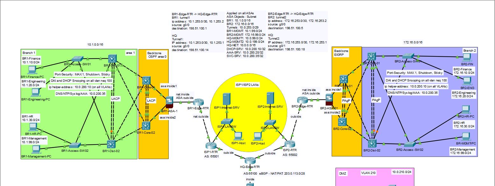
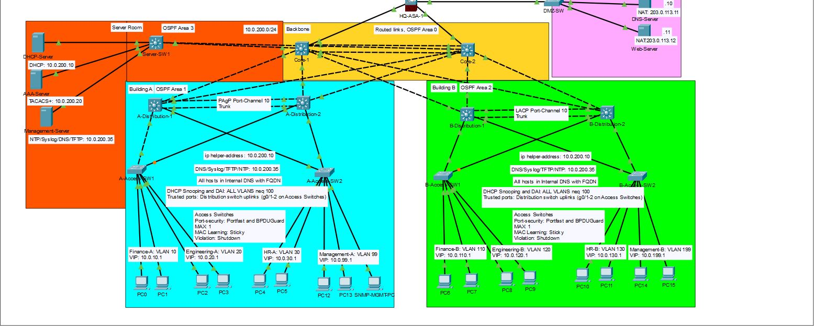

# TNARC Lab 05: Branch Expansion over Encrypted Internet VPNs

## The Problem

TNARC is opening two separate branches, Branch 1 and has aquired a firm (branch 2) that runs EIGRP. Leased private lines are slow to order and expensive, so both branches will connect over ordinary business internet. Client finanacial data will cross the internet so EVERY company flow between sites must be encrypted. Both branches will need HQ's services (DHCP, DNS, AAA, logging) and its servers, and HQ's firewall must still inspect what reaches them. The design must be capable of scaling so when a new branch joins nothing is redesigned. 

## Requirements

1. Every site reaches every other site.
2. All traffic between sites is encrypted.
3. Routes are exchanged dynamically over the tunnels.
4. OSPF and EIGRP share routes at exactly one point.
5. Branch user reach the internet through their own connections.
6. Branch traffic to HQ is inspected by the ASA, with only the needed flows allowed.
7. Branch users get addresses from the HQ DHCP server.
8. Every new device meets Stage 2 and 3 baselines.
9. Tunnels survive the failure of ISP1 at HQ.

## Topology

#### Branch 1

| Device | Model | Role |
|--------|-------|------|
| BR1-Edge-RTR | 2911 | Connects the Network to ISP1 (ISP2 in a real scenario as failover) |
| BR1-ASA-1 | 5506-X | Filtering and Policy management for the branch |
| BR1-Core-1 | 3650 | Routed ports for traffic from Dist 1 and 2, failover with Core-2 via HSRP |
| BR1-Core-2 | 3650 | Routed ports for traffic from Dist 2 and 1, failover with Core-1 via HSRP |
| BR1-Dist-1 | 3650 | STP: Root primary for VLANs 10,20,30, and 99. |
| BR1-Dist-2 | 3650 | STP: Root secondary for VLANs 10,20,30, and 99. Failover for Dist-1. |
| BR1-Access-SW1 | 2960 | Hosts VLANs 10 and 20, Port-security with maximum 1 MAC, sticky learning and shutdown violation |
| BR1-Access-SW2 | 2960 | Hosts VLANs 30 and 99, Port-security with maximum 1 MAC, sticky learning and shutdown violation |

#### Branch 2 

| Device | Model | Role |
|--------|-------|------|
| BR2-Edge-RTR | 2911 | Connects the Network to ISP2 (ISP1 in a real scenario as failover) |
| BR2-ASA-1 | 5506-X | Filtering and Policy management for the branch |
| BR2-Core-1 | 3650 | Routed ports for traffic from Dist 1 and 2, failover with Core-2 via HSRP |
| BR2-Core-2 | 3650 | Routed ports for traffic from Dist 2 and 1, failover with Core-1 via HSRP |
| BR2-Dist-1 | 3650 | STP: Root primary for VLANs 10,20,30, and 99. |
| BR2-Dist-2 | 3650 | STP: Root secondary for VLANs 10,20,30, and 99. Failover for Dist-1. |
| BR2-Access-SW1 | 2960 | Hosts VLANs 10 and 20, Port-security with maximum 1 MAC, sticky learning and shutdown violation |
| BR2-Access-SW2 | 2960 | Hosts VLANs 30 and 99, Port-security with maximum 1 MAC, sticky learning and shutdown violation |

## Network Addressing

| Block | Use | Notes |
|-------|-----|-------|
| 203.0.113.15/32 | HQ-Edge-RTR Loopback1 - Tunnel endpoint | Spare address from TNARC's block |
| 198.51.100.8/30 | ISP1 -> ISP2 | Connection between ISPs for Failover, wishful thinking as it is not currently possible with this router |
| 198.51.100.12/30 | BR1-Edge-RTR -> ISP1 | Public address comes from ISP1 |
| 198.51.100.16/30 | BR2-Edge-RTR -> ISP2 | Public address comes from ISP2 |
| 10.1.253.0/30 | Tunnel1 - HQ-Edge-RTR -> BR1-Edge-RTR | Tunnel address | 
| 172.16.253.0/30 | Tunnel2 - HQ-Edge-RTR -> BR2-Edge-RTR | Tunnel address |
| 10.1.0.0/16 | Branch 1 LANs | Follows the same pattern as HQ for VLANs. |
| 172.16.0.0/16 | Branch 2 LANs (acquired) | Chose this address to spot the EIGRP standout |
| 192.0.2.0/24 | ISP1 LAN | The test network behind ISP1 |
| 192.18.0.0/24 | ISP2 LAN | The test network behind ISP2 |

## Key Decisions

1. Branches connect over ordinary internet with GRE over IPsec instead of private WAN. This makes deployment easier and cheaper to maintain, as close to modern network practices. All sensitive and customer data is encrypted when crossing the internet. 

2. GRE over IPsec instead of plain IPsec, so GRE can carry the multicast of OSPF and EIGRP then IPsec encrypts the GRE.

3. Hub and Spoke architecture through HQ-Edge-RTR, each tunnel connects from HQ to branch and both dynamic routing protocols meet at HQ-Edge-RTR.

4. Pattern across sites ensure architecture (ISP, NAT, VPN, and an ASA) consistency and predicatability.

5. Tunnels end on the Edge-RTR's physical ISP interfaces, because crypto maps in CPT don't support local-address, so IKE can't use a loopback address.

6. IPsec settings: IKEv1, AES-256, SHA, DH group 5, a unique pre-shared key per branch, transform set 'esp-aes 256 esp-sha-hmac'. I decided to use the strongest options CPT allowed and accepted. Ideally I would use IKEv2 with stronger groups and certificates.

7. No default route is sent to the branches because a default route through the tunnel would pull branch internet traffic into the tunnel and break direct internet access.

8. I chose to do a fail closed using an outbound ACL (called "NO-LEAKS") on every ISP facing interface. If a tunnel drops, private company address traffic is denied and dropped.

9. Routing runs only on the tunnel subnets, each site is advertised as a one static /16, redistributed. The ASA's can't run OSPF in CPT, so routes behind them are static. Narrow network statements keep hellos off the LANs and the internet.

10. Company traffic does not get translated by NAT/PAT because NAT ACLs deny company destinations and the tunnels have no NAT role, so HQ sees real branch addresses for routing and logs.

11. Tunnel subnets come from the Branches' range, (ex: BR1= 10.1.253.0/30, BR2=172.16.253.0/30) this allows them to use existing summary routes and firewall rules. When I first configured them to 10.0.253.0/29 using HQ's range, they would cause a loop with HQ-Core-1 and HQ-ASA-1. 

12. Branches are treated as outside at HQ with a rule per service. Each source reaches only the services it uses (DHCP, DNS, AAA, Syslog, NTP, TFTP, SSH) and pinging.

13. Central DHCP for every site, with relay and explicit server-to-relay reply permits. One source for addressing.

14. Predictable paths wherever a stateful device is in the way, alternating equal-cost paths broke the ASA and DHCP relay. HQ: Core-1 preferred (OSPF default metric 10 vs. 50) with a floating ASA route through Core-2. Branch 1: Dist-1 and Core-1 active (OSPF cost 100 towards Dist-2), with HSRP active on Dist-1 for every VLAN.

15. Layer 2 stops at distribution at every site, as at HQ. Keeps broadcasts out of the Core.

16. EIGRP passive on the Branch 2 User VLANs a default route redistributed into internal EIGRP. Stops adjacencies and flapping on user VLANs every Branch 2 switch learns the way out through the ASA.

17. TNARC's 203.0.113.0/24 split into a /28 per site, with ISP static routes for the branch /28s. Each site translates to TNARC's owned addresses.

18. Branch access switches managed on VLAN 100, with AAA, syslog and NTP sent from that interface. Device traffic always comes from a known address inside the branch range, which the HQ firewall rules already cover.

19. SSH into a branch is allowed from management subnets to the whole range, keeps the rule set short within CPT limits.

## Verification

| # | Proves | Test | Expected | Evidence |
|---|--------|------|----------|----------|
| 1 | R1 | Ping host to host on each site | success | [Ping successful](./verification/evidence.md#hq-host-pinging-br1-and-br2-hosts) |
| 2 | R2 | Monitor packets being sent site to site and check that tunnels are active | ESP header in packets and ACTIVE status for tunnels. | [ESP + ACTIVE status](./verification/evidence.md#requirement-2-all-traffic-between-sites-is-encrypted) |
| 3 | R3 | Check Routing Table on Edge-RTR's at each site | Each site's network shared via tunnel1 or tunnel2 | [Routing Tables](./verification/evidence.md#requirement-3-routes-are-exchanged-dynamically-over-the-tunnels) |
| 4 | R4 | Check the OSPF and EIGRP neighbors at HQ Edge Router | Both Routing protocols shared at HQ | [Routing Protocol Neighbors](./verification/evidence.md#requirement-4-ospf-and-eigrp-share-routes-at-exactly-one-point)
| 5 | R5 | Web browse from a host at both branches | Successfully reach web server behind ISPs | [ISP web servers reached](./verification/evidence.md#requirement-5-branch-user-reach-the-internet-through-their-own-connections) |
| 6 | R6 | Check list of ACL's at HQ and other branch firewalls | Only the needed service/traffic flows allowed. | [Firewalls rules and policies](./verification/evidence.md#requirement-6-branch-traffic-to-hq-is-inspected-by-the-asa-with-only-the-needed-flows-allowed) |
| 7 | R7 | Release and renew IP lease on BR1 and BR2 host PCs | Successful DHCP assignments from centralized server at HQ | [DHCP request successful](./verification/evidence.md#requirement-7-branch-users-get-addresses-from-the-hq-dhcp-server) |
| 8 | R8 | Cross reference security baselines between HQ and Branches | Branches meet Lab 2 and Lab 3 hardening security baselines | [Config files](./configs/) |
| 9 | R9 | Simulate a router crash at either ISP to show tunnel failover | Tunnels 3 and 4 takeover when tunnel 1 and 2 fail | [Failed](./verification/Requirement9.md) |

## Challenges and Fixes

1. When EIGRP was added there was some flapping happening with the HSRP for all VLANs. This was being caused by goodbye messages being sent to the VLANs because of EIGRP passive interfaces not being set. The fix was simply setting each vlan's interface in 'passive-interface' mode and the port interfaces that host the VLANs as well.

2. DHCP 'DORA' experienced a problem with packet splitting at the Distribution and Core switches, this would cause the host to not receive the final ACK of the DHCP address assignments. I decided to make Dist-1 the main switch for all traffic for all VLANs (for each branch), and Dist-2 will be used as a backup path when Dist-1 goes down. This allowed all packet traffic to go through the same path and completing the DORA successfully.

3. CPT's ASA silently installed UDP rules incorrectly at the HQ ASA. All services were denied even though the rules (using objects) were correct. The cause was due to the ASA expanding UDP rules using objects into a TCP rules with a malformed UDP rule. The fix was just switching these affected rules from using Objects to plain subnets.

4. Asymmetric routing through a stateful firewall caused every other ping to an HQ host to drop. Equal-cost default routes through both cores sent replied to the ASA's second inside interface, where the connection wasn't recorded. The fix was simply switching the Core-1's configuration to preferred, with a floating backup route on the ASA.

5. After powering off and adding Serial ports to Branch 1 and Branch 2's Edge-RTRs wiped the entire tunnel configuration on both routers. It was quickly found because only the tunnels were refusing pings, after checking the "show run | section crypto" I noticed that was the single configuration wiped. The fix was to re-enable the security license to ensure it was active, then rebooted to ensure it loaded without fail this time. After the license loaded successfully, I reconfigured the tunnels and they were back to running normally. 

## Limitations

1. No ISP redundancy at the branches, the ISP routers ran out of routing ports. The design for it is documented above. This is a CPT limitation and would not stand in production.

2. No crypto map local-address: tunnels end on physical interfaces instead of loopbacks.

3. No route-maps or distribute-lists: redistribution can't be filtered, so the static routes are kept minimal.

4. No object-groups, and UDP rules with objects install incorrectly, so rules are written with plain subnets.

5. The ASA doesn't support logging host or aaa-server in Packet Tracer, so the ASAs use local accounts and their deny counters as evidence.

6. The ASA runs some replies to its own traffic through the interface ACL, so narrow workaround permits were added.

7. IKEv1 with pre-shared keys: production would use IKEv2 and certificates.

8. The two ISPs aren't interconnected, so a host behind ISP1 can't reach one behind ISP2.

9. Branch /28 prefixes would be filtered on the public internet; production branches would use ISP-assigned addresses.

10. NTP synchronization isn't simulated in Packet Tracer.

## What I'd do next 
