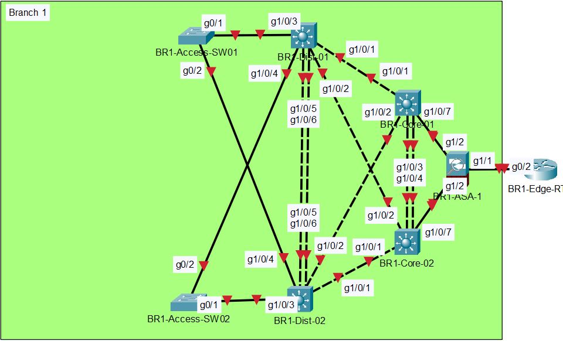

# Branch 1

## BR1-Core-01
| Port | | Device | Port | Subnet | IP Address | Protocol |
|------|-|--------|------|--------|------------|----------|
| g1/0/1 | -> | BR1-Dist-01 | g1/0/1 | 10.1.255.0/30 | 10.1.255.1 |
| g1/0/2 | -> | BR1-Dist-02 | g1/0/2 | 10.1.255.8/30 | 10.1.255.9 |
| g1/0/3 | -> | BR1-Core-02 | g1/0/3 | 10.1.255.32/30 | 10.1.255.33 | LACP |
| g1/0/4 | -> | BR1-Core-02 | g1/0/4 | 10.1.255.32/30 | 10.1.255.33 | LACP |
| g1/0/7 | -> | BR1-ASA-1 | g1/2 | 10.1.255.56/30 | 10.1.255.57 |
| loopback0 | | | | 10.1.254.1/32 | 10.1.254.1 |

## BR1-Core-02
| Port | | Device | Port | Subnet | IP Address | Protocol |
|------|-|--------|------|--------|------------|----------|
| g1/0/1 | -> | BR1-Dist-02 | g1/0/1 | 10.1.255.4/30 | 10.1.255.5 |
| g1/0/2 | -> | BR1-Dist-01 | g1/0/2 | 10.1.255.12/30 | 10.1.255.13 |
| g1/0/3 | -> | BR1-Core-01 | g1/0/3 | 10.1.255.32/30 | 10.1.255.34 | LACP |
| g1/0/4 | -> | BR1-Core-01 | g1/0/4 | 10.1.255.32/30 | 10.1.255.34 | LACP |
| g1/0/7 | -> | BR1-ASA-1 | g1/2 | 10.1.255.60/30 | 10.1.255.61 | 
| loopback0 | | | | 10.1.254.2/32 | 10.1.254.2 |

## BR1-Dist-01
| Port | | Device | Port | Subnet | IP Address | Protocol |
|------|-|--------|------|--------|------------|----------|
| g1/0/1 | -> | BR1-Core-01 | g1/0/1 | 10.1.255.0/30 | 10.1.255.2 |
| g1/0/2 | -> | BR1-Core-02 | g1/0/2 | 10.1.255.12/30 | 10.1.255.14 |
| g1/0/3 | -> | BR1-Access-SW01 | g0/1 |
| g1/0/4 | -> | BR1-Access-SW02 | g0/2 |
| g1/0/5 | -> | BR1-Dist-02 | g1/0/5 | 10.1.255.36/30 | 10.1.255.37 | LACP |
| g1/0/6 | -> | BR1-Dist-02 | g1/0/6 | 10.1.255.36/30 | 10.1.255.37 | LACP |
| loopback0 | | | | 10.1.254.3/32 | 10.1.254.3 |

#### SVI
| VLAN | Subnet | IP address | VIP | Priority | Preempt | Primary/Secondary |
|------|--------|------------|-----|----------|---------|-------------------|
| 10 | 10.1.10.0/24 | 10.1.10.2 | 10.1.10.1 | 150 | True | Primary |
| 20 | 10.1.20.0/24 | 10.1.20.2 | 10.1.20.1 | 150 | True | Primary |
| 30 | 10.1.30.0/24 | 10.1.30.3 | 10.1.30.1 | 90 | False | Secondary |
| 99 | 10.1.99.0/24 | 10.1.99.3 | 10.1.99.1 | 90 | False | Secondary |

## BR1-Dist-02
| Port | | Device | Port | Subnet | IP Address | Protocol |
|------|-|--------|------|--------|------------|----------|
| g1/0/1 | -> | BR1-Core-02 | g1/0/1 | 10.1.255.4/30 | 10.1.255.6 |
| g1/0/2 | -> | BR1-Core-01 | g1/0/2 | 10.1.255.8/30 | 10.1.255.10 |
| g1/0/3 | -> | BR1-Access-SW2 | g0/1 |
| g1/0/4 | -> | BR1-Access-SW1 | g0/2 |
| g1/0/5 | -> | BR1-Dist-01 | g1/0/5 | 10.1.255.36/30 | 10.1.255.38 | LACP |
| g1/0/6 | -> | BR1-Dist-01 | g1/0/6 | 10.1.255.36/30 | 10.1.255.38 | LACP |
| loopback0 | | | | 10.1.254.4/32 | 10.1.254.4 |

#### SVI 
| VLAN | Subnet | IP address | VIP | Priority | Preempt | Primary/Secondary |
|------|--------|------------|-----|----------|---------|-------------------|
| 10 | 10.1.10.0/24 | 10.1.10.3 | 10.1.10.1 | 90 | False | Secondary |
| 20 | 10.1.20.0/24 | 10.1.20.3 | 10.1.20.1 | 90 | False | Secondary |
| 30 | 10.1.30.0/24 | 10.1.30.2 | 10.1.30.1 | 150 | True | Primary |
| 99 | 10.1.99.0/24 | 10.1.99.2 | 10.1.99.1 | 150 | True | Primary |

## BR1-Access-SW01
| Port | Switchport Mode | VLAN(s) | Native |
|------|-----------------|---------|--------|
| g0/1 | Trunk | 10,20,777 | 777 |
| g0/2 | Trunk | 10,20,777 | 777 |
| f0/1 | Access | 10 | |
| f0/2 | Access | 20 | |
| all unused | access | 999 |

## BR1-Access-SW02
| Port | Switchport Mode | VLAN(s) | Native |
|------|-----------------|---------|--------|
| g0/1 | Trunk | 30,99,777 | 777 |
| g0/2 | Trunk | 30,99,777 | 777 |
| f0/1 | Access | 30 | |
| f0/2 | Access | 99 | |
| all unused | access | 999 |

## BR1-ASA-1
| Port | | Device | Port | Subnet | IP Address |
|------|-|--------|------|--------|------------|

## BR1-Edge-RTR
| Port | | Device | Port | Subnet | IP Address |
|------|-|--------|------|--------|------------|

# Branch 2

## BR2-Core-01
| Port | | Device | Port | Subnet | IP Address |
|------|-|--------|------|--------|------------|

## BR2-Core-02
| Port | | Device | Port | Subnet | IP Address |
|------|-|--------|------|--------|------------|

## BR2-Dist-01
| Port | | Device | Port | Subnet | IP Address |
|------|-|--------|------|--------|------------|

## BR2-Dist-02
| Port | | Device | Port | Subnet | IP Address |
|------|-|--------|------|--------|------------|

## BR2-Access-SW01

## BR2-Access-SW02

## BR2-ASA-1
| Port | | Device | Port | Subnet | IP Address |
|------|-|--------|------|--------|------------|

## BR2-Edge-RTR
| Port | | Device | Port | Subnet | IP Address |
|------|-|--------|------|--------|------------|