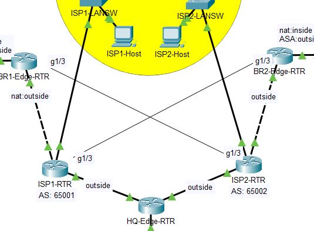

# How redundancy would be configured

### Addresses

| Device | tunnel | link | Device | subnet | addresses | Tunnel subnet | Tunnel addresses |
|--------|--------|------|--------|--------|-----------|---------------|------------------|
| BR1-Edge-RTR | tunnel 11 | <-> | ISP2-RTR | 198.51.100.28/30 | ISP2 .29, BR1 .30 | 10.1.253.4/30 | HQ .5, BR1 .6 |
| BR2-Edge-RTR | tunnel 12 | <-> | ISP1-RTR | 198.51.100.32/30 | ISP1 .33, BR2 .34 | 172.16.253.4/30 | HQ .5, BR1 .6 |

### ISP router configurations 

| Device | interface | description | ip address | netmask |
|--------|-----------|-------------|------------|---------|
| ISP2-RTR | g1/3 | To BR1 backup | 198.51.100.29 | 255.255.255.252 |
| ISP1-RTR | g1/3 | To BR2 backup | 198.51.100.33 | 255.255.255.252 | 

| Device | router protocol | AS | network | netmask | add/remove |
|--------|-----------------|----|---------|---------|------------|
| ISP2-RTR | BGP | 65002 | 198.51.100.28 | 255.255.255.252 | add |
| ISP1-RTR | BGP | 65001 | 198.51.100.32 | 255.255.255.252 | add |

