# Requirement 1: Every site reaches every other site.

#### HQ-Host pinging BR1 and BR2 hosts

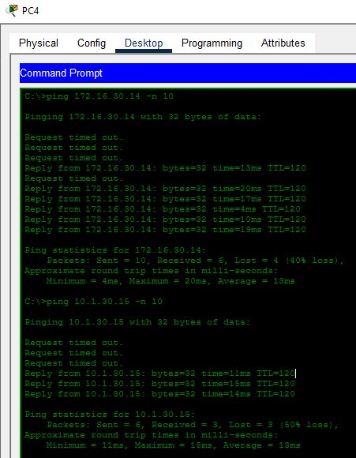

#### BR1-Host pinging HQ and BR2 hosts

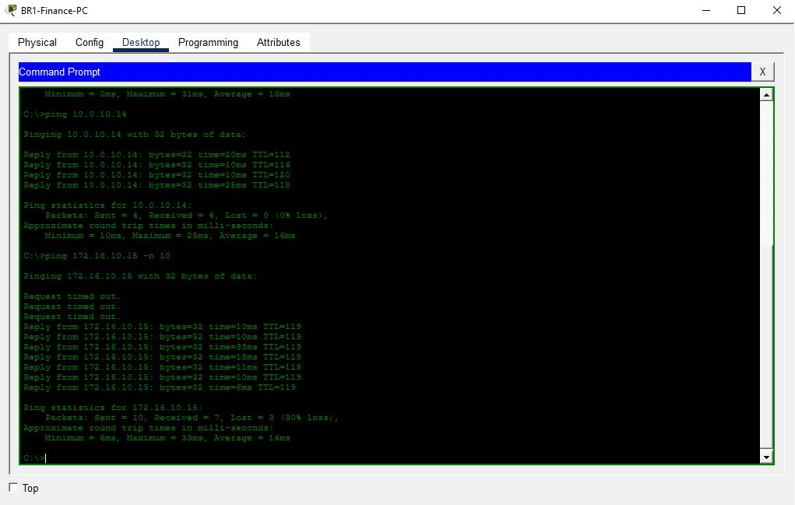

#### BR2-host pinging HQ and BR2 hosts

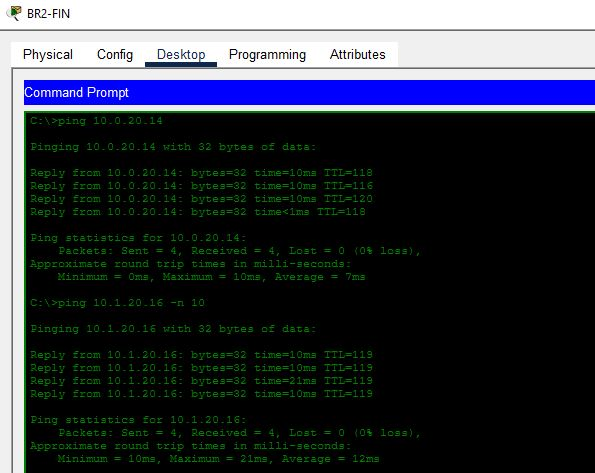

# Requirement 2: All traffic between sites is encrypted.

#### BR1 to HQ tunnel + Encrypted packet

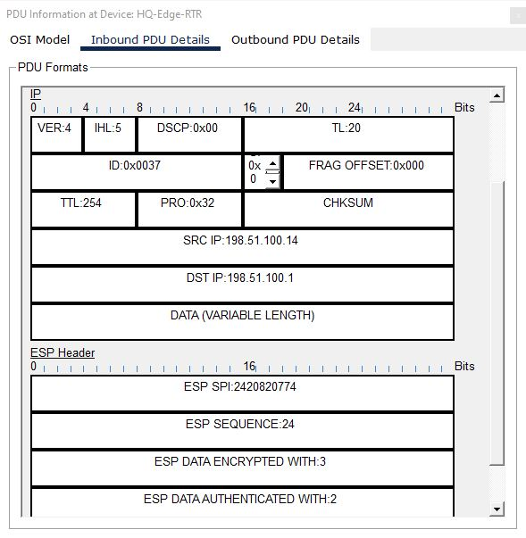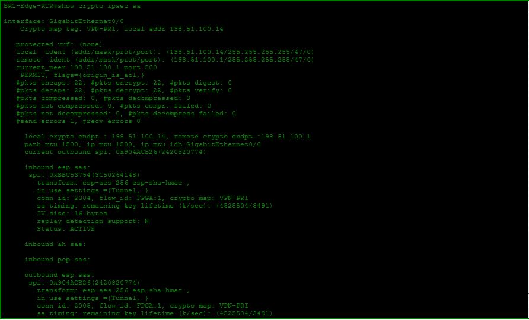

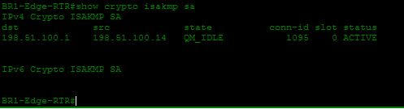

#### BR2 to HQ tunnel + Encrypted packet

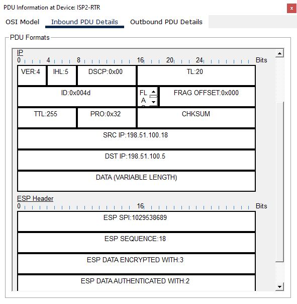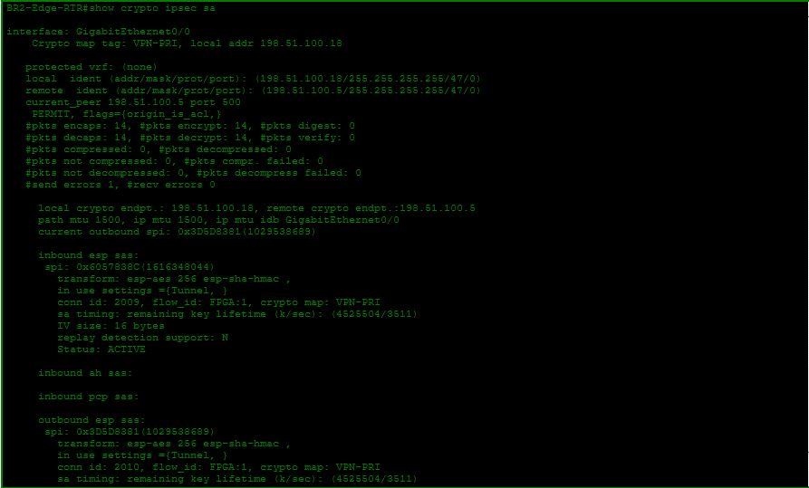

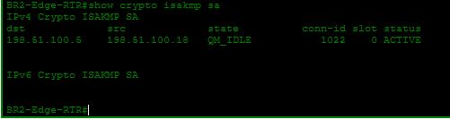

# Requirement 3: Routes are exchanged dynamically over the tunnels.

#### HQ Routing Table

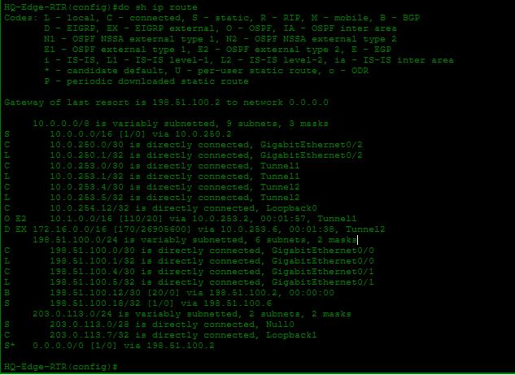

#### BR1 Routing Table

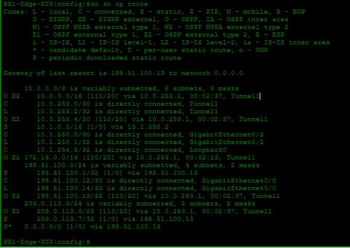

#### BR2 Routing Table

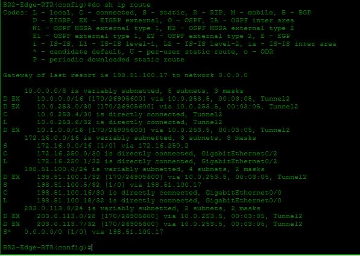

# Requirement 4: OSPF and EIGRP share routes at exactly one point.

#### HQ dynamic routing OSPF and EIGRP via tunnels.

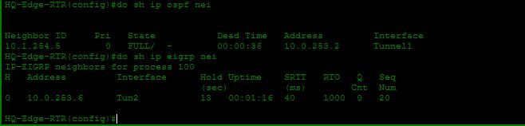

# Requirement 5: Branch user reach the internet through their own connections.

# Requirement 6: Branch traffic to HQ is inspected by the ASA, with only the needed flows allowed.

[The full list of ACLs can be found here](../ASA_ACLs.md)

# Requirement 7: Branch users get addresses from the HQ DHCP server.

#### BR1 Host DHCP request

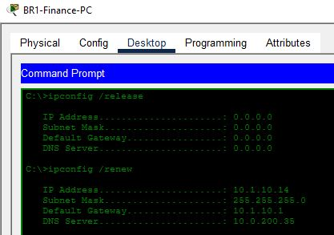

#### BR2 Host DHCP request

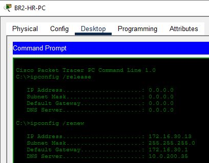

# Requirement 8: Every new device meets Stage 2 and 3 baselines.

# Requirement 9: Tunnels survive the failure of ISP1 at HQ.